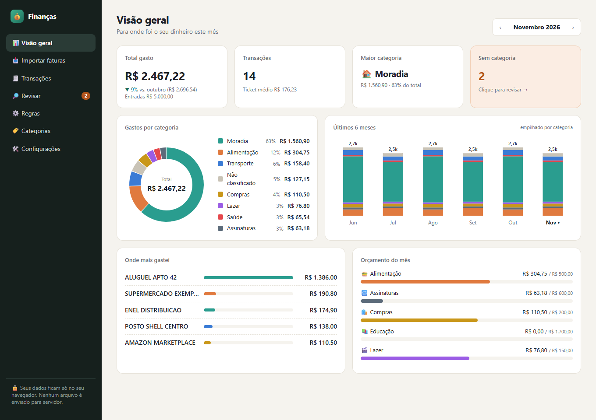

# Finanças Pessoais

Importe os extratos e as faturas do seu banco e veja para onde foi o dinheiro: classificação automática por categoria, gráficos mensais e planilha exportável. Tudo roda no navegador, sem servidor.



_Print com dados fictícios._

## Privacidade

- Os arquivos são lidos no próprio navegador. Nenhum PDF ou CSV é enviado para servidor.
- Transações, regras e categorias ficam no IndexedDB do navegador, só na sua máquina.
- Por isso os dados não aparecem em outro computador nem em outro navegador. Para levá-los, use o backup em Configurações.
- Exceção opcional, desligada por padrão: os lembretes de anotações no WhatsApp. Quando você liga o envio em Configurações, o título, o texto e a data das anotações com lembrete passam pelo [CallMeBot](https://www.callmebot.com/blog/free-api-whatsapp-messages/), que manda a mensagem só para o seu número. Transações e arquivos nunca saem. A chave do serviço fica só no navegador e não vai no backup. O aviso sai com o app aberto em alguma aba; o que vencer com ele fechado sai assim que você abrir.
- Limpar os dados do site no navegador apaga tudo. Faça backups de vez em quando.
- O `.gitignore` bloqueia `*.pdf`, `*.xlsx`, `*.ofx` e a pasta `faturas/`. Nunca versione faturas reais: os testes usam apenas dados fictícios.

## Como funciona

1. **Importar:** arraste o PDF ou CSV. O app detecta o banco, mostra uma prévia e avisa sobre duplicatas. O mesmo extrato em PDF e em CSV não duplica transações.
2. **Classificar:** cada transação passa pela sua classificação manual, depois pelas suas regras (CNPJ/CPF antes de nome) e por fim pelas palavras-chave padrão.
3. **Revisar:** o que sobrar aparece agrupado por nome ou CNPJ. Escolha a categoria uma vez e a regra vale para transações antigas e futuras.
4. **Acompanhar:** veja a visão geral do mês e exporte a planilha em XLSX ou CSV.

Pix recebidos e estornos ficam em "Entradas", fora do total de gastos. Pagamentos de fatura também ficam fora, porque as compras já contam na própria fatura.

## Bancos suportados

| Banco  | Formato                        | Situação                                           |
| ------ | ------------------------------ | -------------------------------------------------- |
| Inter  | Extrato em PDF e CSV           | Validado com extrato real                          |
| Nubank | Fatura em PDF                  | Parser inicial, ainda não validado com fatura real |
| Itaú   | PDF                            | Usa o parser genérico                              |
| Outros | PDF com linhas de data e valor | Parser genérico                                    |

No CSV do Inter, algumas compras podem vir sem descrição. Quando isso acontecer, prefira o PDF do mesmo período.

## Como rodar

Requer Node.js 22 ou mais recente.

```bash
npm install
npm run dev
```

| Comando         | O que faz                       |
| --------------- | ------------------------------- |
| `npm run dev`   | Servidor de desenvolvimento     |
| `npm run build` | Checa os tipos e gera o `dist/` |
| `npm test`      | Roda os testes                  |
| `npm run lint`  | Roda o ESLint                   |

### Com Docker

```bash
docker compose up -d --build
```

Abra http://localhost:8080. Para parar, use `docker compose down`.

Os dados ficam no navegador, não no container: parar ou recriar o container não apaga nada. Eles também são separados dos dados do site publicado e do `npm run dev`, porque cada endereço tem o próprio armazenamento.

## Como adicionar um banco

1. Crie `src/features/import/parsers/meubanco.ts` exportando um `BankParser`:

   ```ts
   export const meuBancoParser: BankParser = {
     id: 'meubanco',
     name: 'Meu Banco',
     detect: (text) => /MEU BANCO/.test(normalizeText(text)),
     parse: (text) => [], // uma entrada por transação: { date, description, amount }
   };
   ```

   `date` é `yyyy-mm-dd`, e `amount` é em centavos: negativo para saída, positivo para entrada.

2. Registre o parser na lista `PARSERS` de `src/features/import/parsers/index.ts`.
3. Crie um exemplo **fictício** em `src/tests/fixtures/` e os testes em `src/tests/parsers.test.ts`.

Descrições com código único por transação, como `Sitpass*1T260810-JD60`, precisam de um apelido em `ALIASES`, no arquivo `src/features/classify/normalize.ts`. Sem isso, cada transação vira um grupo separado na Revisão.

## Como contribuir

A `main` é protegida: toda mudança entra por pull request e só pode ser mergeada com dois checks verdes.

- **`check`**: lint, testes e build (`.github/workflows/ci.yml`).
- **`argos`**: revisão de QA feita pelo Claude Code com a skill [`.claude/skills/argos`](.claude/skills/argos/SKILL.md). Ela procura dados reais no repositório, mudanças de schema que apagam dados, quebra do dedupe de importação, parser sem teste e dados saindo do navegador.

Fluxo:

```bash
git checkout -b feat/minha-mudanca
# ...commits...
git push -u origin feat/minha-mudanca
gh pr create --fill
```

Depois, numa sessão do Claude Code neste repositório, rode `/argos <número-da-PR>`. O Argos comenta na PR, marca o status `argos` no commit e, se o veredito for go, faz o merge com squash. Um push novo na PR invalida o veredito: rode o Argos de novo.

## Stack

Vite, React, TypeScript, Tailwind CSS, pdf.js, Dexie (IndexedDB), Recharts, SheetJS, Vitest e React Router. O site é publicado no GitHub Pages pelo GitHub Actions.

## Roadmap

- Classificação por IA como sugestão opcional, enviando só o nome normalizado e nunca o arquivo
- OCR para PDFs escaneados (tesseract.js)
- Importar OFX e CSV de outros bancos
- Metas e alertas de orçamento

## Licença

[MIT](LICENSE)
